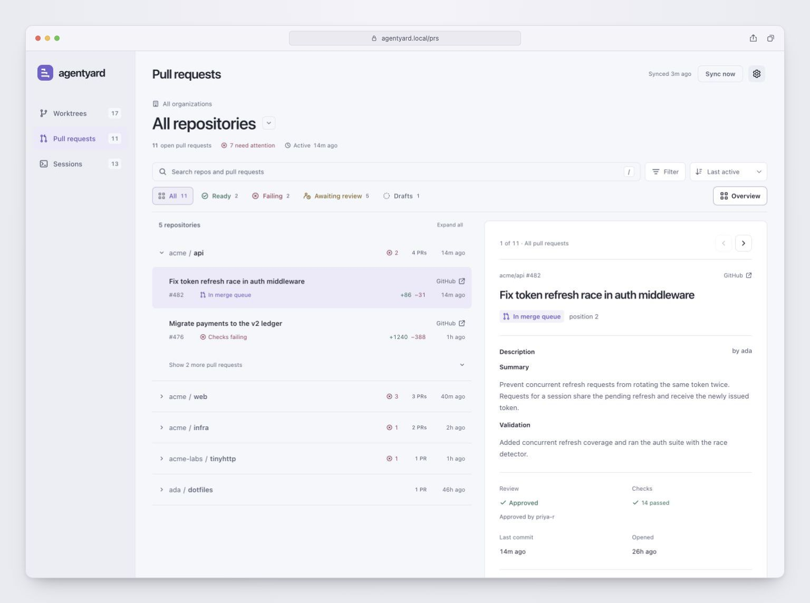
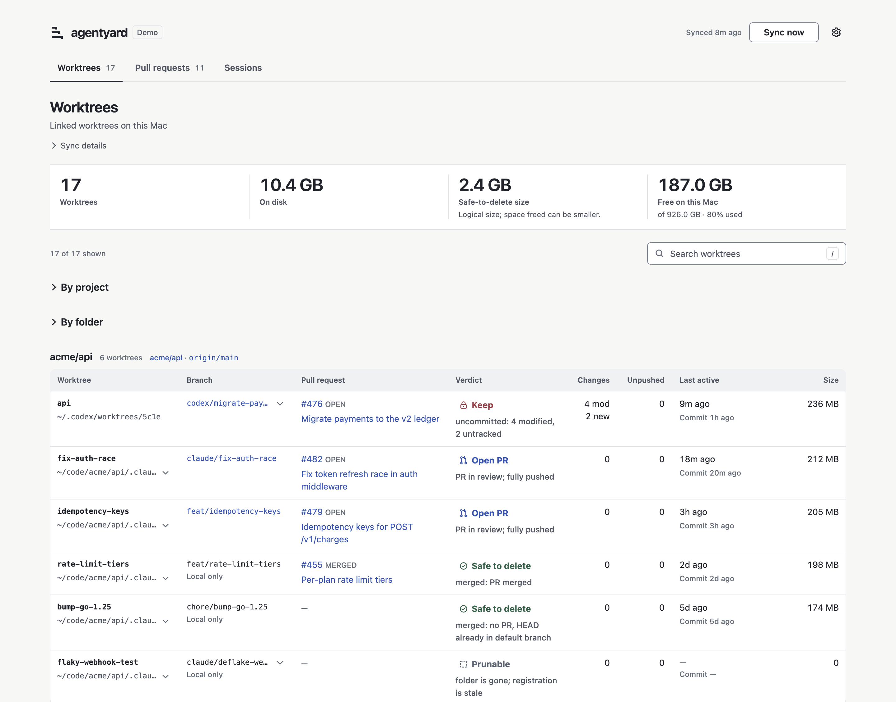
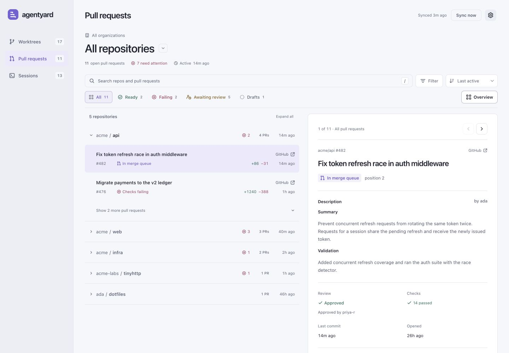
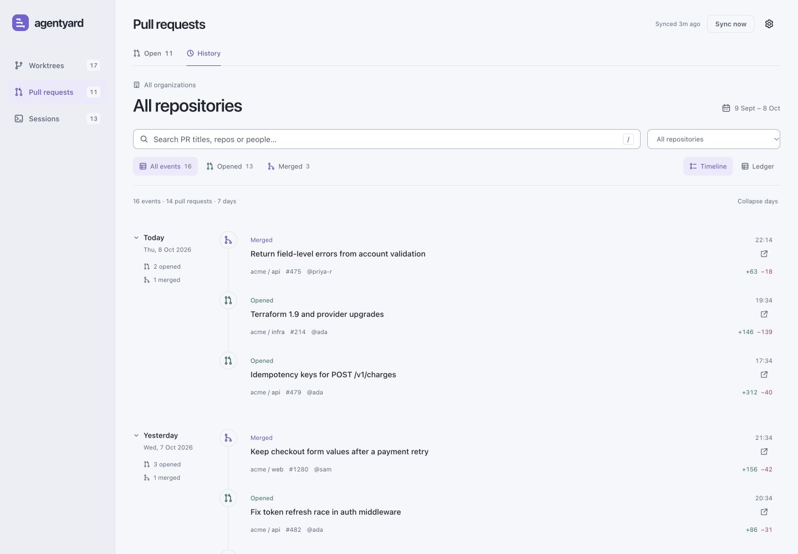
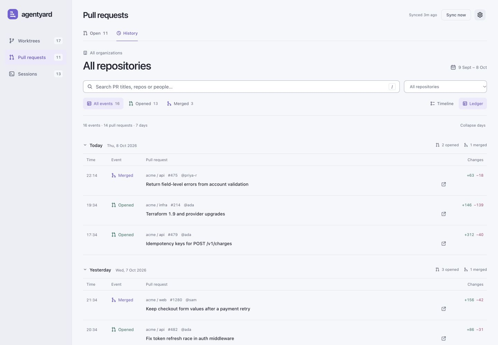
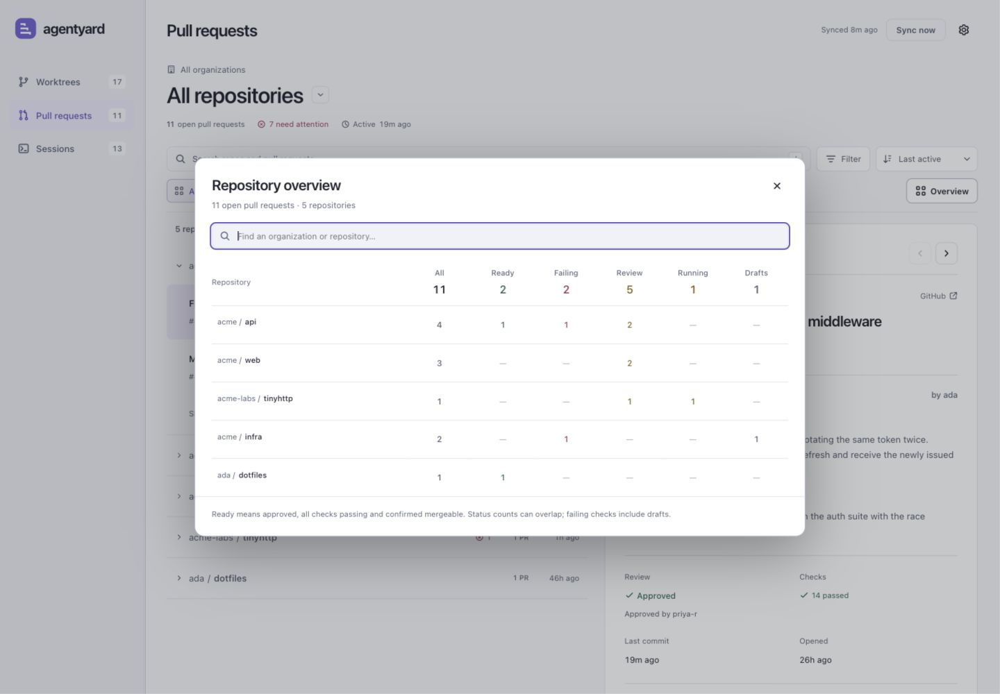
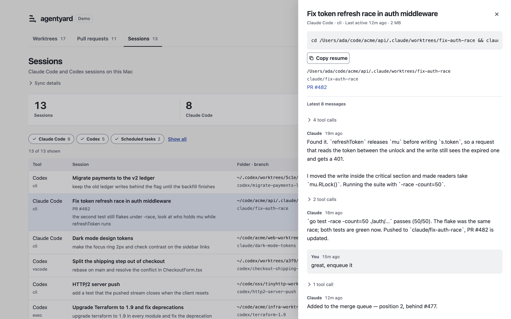
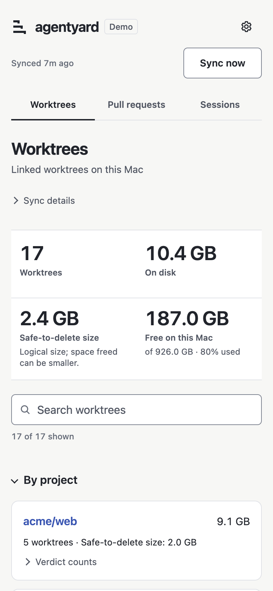
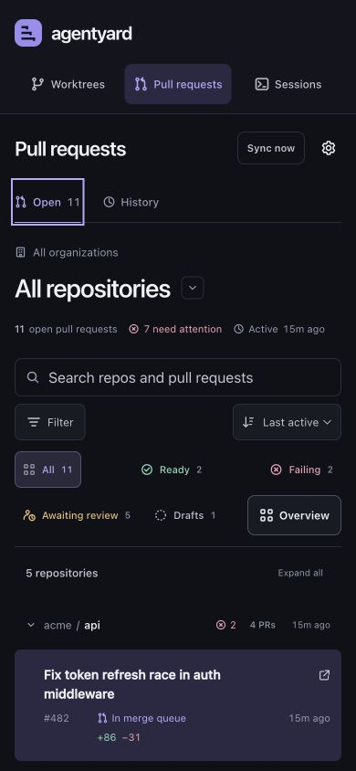

<div align="center">

<picture>
  <source media="(prefers-color-scheme: dark)" srcset="assets/logo-dark.svg">
  
</picture>

### The yard where your coding agents work.

Every git worktree, open pull request and Claude Code / Codex session on one calm page.<br>
One Go binary. No dependencies. Runs quietly in the background on your Mac.

[](https://github.com/MilosMosovsky/agentyard/actions/workflows/ci.yml)
[](https://github.com/MilosMosovsky/agentyard/releases/latest)
[](https://pkg.go.dev/github.com/MilosMosovsky/agentyard)
[](go.mod)
[](LICENSE)
[](#faq)
[](#homebrew)

[Quick start](#quick-start) ·
[Tour](#a-tour) ·
[Install](#install) ·
[Background agent](#run-in-the-background) ·
[AI cleanup](#let-your-ai-clean-up) ·
[Configuration](#configuration) ·
[Privacy](#privacy-and-security) ·
[How it works](#how-it-works) ·
[FAQ](#faq)

<br>

<picture>
  <source media="(prefers-color-scheme: dark)" srcset="docs/screenshots/prs-appshot-dark.jpg">
  
</picture>

<sub>Every screenshot here is <code>agentyard demo</code>: synthetic data, nothing from a real machine.</sub>

</div>

## Why

Run ten coding agents in parallel and by Friday you have forty worktrees, a dozen open PRs and a
hundred sessions you cannot find again. Which folders are safe to delete? Which PR is stuck, and on
what? Where was the session that fixed the auth race? agentyard answers all three on one page, and
keeps the answers fresh while you work.

## Quick start

```sh
brew install MilosMosovsky/tap/agentyard
agentyard demo       # the full UI on synthetic data, in two seconds
agentyard install    # run it at login on http://localhost:4777 (asks first)
```

## A tour

### Worktrees

<picture>
  <source media="(prefers-color-scheme: dark)" srcset="docs/screenshots/worktrees-dark.png">
  
</picture>

Every 5 minutes agentyard finds each repository under your root folder that has linked worktrees,
fetches it, looks up each branch's pull request, and gives every worktree one verdict:

| Verdict | Meaning |
|---|---|
| **Safe to delete** | PR merged (or HEAD already in the default branch), and nothing local is missing from the remote: the worktree is clean, or every uncommitted file and local commit is already in the default branch by content. The only verdict that is safe to delete. |
| **Prunable** | The folder is gone; only git's registration is left, and every commit it had is on a branch, tag or remote. |
| **In use** | Otherwise Safe to delete, but a process or live Claude Code session is using it. Wait until that use ends. |
| **Not merged** | Nothing local is missing from the remote, but it was never merged into the default branch (closed PR, no PR, or its changes live on another branch). Needs a human decision. |
| **Open PR** | The branch has a PR in review. |
| **Keep** | Work that no remote has: uncommitted files or local commits whose content is on no remote branch, another checkout inside its ignored folders, a submodule holding work its origin lacks (changes, untracked files, a stash, worktrees of its own, or commits on no branch of its origin), or files git status cannot see (assume-unchanged, skip-worktree, or a clean filter other than Git LFS's). |

In use is checked on every scan. A process whose working folder is the worktree, or any folder
inside it, uses that worktree. Folders are compared by what they are on disk, not by how their path
is spelled, so a symlink, `/tmp` against `/private/tmp`, a different letter case on a
case-insensitive disk or a name `lsof` prints escaped all still match; a process at the repository
root does not use the worktrees nested under it. Only agentyard's own work is ignored: agentyard
itself and the git, `lsof`, `ps` and `du` commands it runs, plus git's file-watching daemon. A shell
or an agent is a user even when an agentyard started it. Live Claude Code sessions
(`~/.claude/sessions`, or `-claude-dir`) name the session, and a worktree inside a live session's
scratchpad is in use even with no process in it; a session file counts as live while its process
runs, checked against its start time so a reused pid does not count. Worktrees with any other verdict
keep it and show an in-use chip. When the check itself fails (`lsof` cannot run, the sessions folder
cannot be read), no worktree is Safe to delete: each is In use, with the reason, until a scan can
check again. What it cannot see: another user's processes (and, on Linux, ones the kernel will not show, such as
`systemd --user`), and a program that works on files in a
worktree without its working folder being there (an editor opened from elsewhere, say). The verdict
is what the last scan saw; a removal checks again when it runs.

Keep is decided by content, not by commit hash. Commits often reach GitHub another way (rebased,
squash-merged, ported to another branch) and uncommitted files are often identical to what was pushed
later, so a hash check alone keeps far more than it needs to. When a worktree has uncommitted files or
commits no remote has by hash, agentyard snapshots its state (HEAD plus every uncommitted and
untracked, non-ignored file) and merges it three-way into the default branch, the branch's own remote
counterpart, its PR head, and the most recently updated remote branches containing its last pushed
commit. If one of those merges is clean and changes nothing, that ref already has everything, and the
worktree is judged as if it were clean and pushed, except that uncommitted files make it Safe to
delete only when they are in the default branch itself (elsewhere it is Not merged). The staged
version is checked as well when it differs from the file on disk, and the history fallback (a file
reverted to a version pushed earlier) compares file modes too. Anything git's comparison cannot vouch
for keeps the worktree: a submodule or nested repository among the changes, a changed file with a
clean/smudge filter (Git LFS included) or a custom merge driver, more than 1000 changed paths, or
more than 5000 untracked files or 64 MB of them. The snapshot uses a copy of the index and a
throwaway object directory, so a scan never writes to the repository.

An interactive treemap shows measured disk usage by worktree or repository. Select a tile for its verdict and path, or jump to its row. Search, verdict, and repository filters update the chart, totals, and list together. Choose several values in the Filter menu; remove any selection individually.

Totals are grouped by repository and by folder, with ready-to-copy `agentyard remove <path>` commands
for the safe-to-delete rows. The command runs the same re-checked removal as the dashboard's Remove
and `remove_worktrees` (see below), so one copied an hour ago still refuses a worktree that has come
into use or gained work since; `agentyard remove -dry-run <path>` only reports. Rows and repositories are sorted by last activity: the newest of the last
commit, the worktree's index and any uncommitted file. Sizes are `du` logical sizes, refreshed every
30 minutes; APFS clones and package-manager hardlinks mean the space you actually free can be smaller.

#### Removing from the dashboard

On the Mac that runs agentyard, a Safe to delete or Prunable row has a **Remove** button, and each
repository's cleanup panel has **Remove all**. Other devices on your network see the copy-ready
commands only, whatever `--sessions-lan` says.

1. Pressing Remove opens a dialog and runs a **dry run**: nothing is removed yet. It lists what will
   go, what will not and why, the ignored files that go with the folder (`.env` and the like), and,
   for a worktree with uncommitted files, which files are discarded, the ref that already has them
   and the ref where a copy is kept.
2. **Confirm** removes them. The worktrees are re-checked first (see
   [how removal stays safe](#how-removal-stays-safe)); one that changed since the dry run is refused,
   not removed. The result lists each outcome and the space freed, and the rows disappear once the
   rescan lands.

What is deleted is the worktree folder and git's registration of it, ignored files included. Branches
are never deleted. Removal has one implementation and two ways in: this dialog (`POST /api/remove`,
answered only for a browser on this Mac) and the [MCP server](#let-your-ai-clean-up)'s
`remove_worktrees` tool. `agentyard demo` shows the same dialog and removes nothing.

### Pull requests

<picture>
  <source media="(prefers-color-scheme: dark)" srcset="docs/screenshots/prs-dark.jpg">
  
</picture>

Every open PR you authored (`is:pr is:open author:@me archived:false`, as whoever `gh` is logged in
as), newest commit first. Each one gets the single state that decides what happens next, checked in
this order:

| State | Shown when | Detail line |
|---|---|---|
| **In merge queue** | it is queued | its position |
| **Draft** | it is a draft | not ready for review |
| **Conflicts** | it does not merge cleanly | rebase onto the base branch |
| **Checks failing** | any check failed | the failing checks, by name |
| **Changes requested** | a reviewer asked for changes | who asked |
| **Checks pending** | checks are still running | how many |
| **Awaiting review** | approval is missing or a review is required | who it is waiting on |
| **Behind base** | the branch is out of date | update the branch |
| **Blocked** | branch protection is not satisfied | |
| **Ready to merge** | approved, passing checks, and GitHub confirms a clean merge; not draft or queued | who approved it |
| **Checks unconfirmed** | passing checks are not confirmed | missing check evidence |
| **Mergeability unknown** | GitHub has not confirmed a clean merge | missing merge evidence |

The overview groups PRs under compact `organization / repository` headings. Counts, attention
indicators, and the latest commit time remain visible when a repository is collapsed. Groups follow
your activity or name sort. Expanded repositories preview two PRs; **Show more** opens the rest.
Each PR card shows green added-line and red deleted-line counts; narrow cards place them on a second
metadata line to keep the status readable.

Select a PR to read its description, changed files, checks, reviews, branch, and linked local worktree
in the sticky reader. The list scrolls with the page. **GitHub** links on each row and in the reader
open the PR directly. On a phone, selection opens the reader with a **Back to pull requests** action.

Use **Ready**, **Failing**, **Awaiting review**, and **Drafts** above the list for quick status views.
Counts respect the current search and repository scope. **Filter** adds checks running, needs-action,
and queued views, plus multiple selections. Statuses can overlap: a failing draft appears in both
Failing and Drafts. Ready requires explicit approval, at least one passing check, a successful check
rollup with no failures or pending checks, and confirmed clean mergeability.

**Overview** opens a searchable repository/status matrix without replacing the default PR list.
It shows all open PRs; click a repository or count to open those matching PRs. On phones, the matrix
becomes repository cards with labeled counts. The reader's arrows and **← / →** keys move through
the filtered results in list order, reveal the selected PR, and show your position. Arrow shortcuts
leave typing and open dialogs alone and respect the Keyboard shortcuts setting.

**History** shows PRs you authored that were opened or merged in the last 30 days, including PRs
opened earlier and merged recently. Switch between **Timeline** and **Ledger**; your view preference
is remembered. Both share search, repository and event filters. Days follow your browser's timezone,
with opened/merged counts retained when collapsed. Select an event for lifecycle timestamps, actors,
and change size, or use its GitHub link. The Open inbox remains the default.

History syncs in the background and survives restarts. Failed syncs retain the last good snapshot
with a notice. Each opened/merged search is limited to 1,000 PRs; a notice appears if results are partial.

<details>
<summary>PR history: timeline and ledger</summary>
<picture>
  <source media="(prefers-color-scheme: dark)" srcset="docs/screenshots/prs-history-timeline-dark.jpg">
  
</picture>
<picture>
  <source media="(prefers-color-scheme: dark)" srcset="docs/screenshots/prs-history-ledger-dark.jpg">
  
</picture>
</details>

<details>
<summary>Repository overview</summary>
<picture>
  <source media="(prefers-color-scheme: dark)" srcset="docs/screenshots/prs-overview-dark.jpg">
  
</picture>
</details>

The repository heading's picker narrows by organization or repository. Search and filters show all
matching results without the two-PR preview limit. Active selections can be removed individually;
filters, sorting, repository expansion, and the selected PR persist for the browser session.

### Merge train

The **Merge train** view in Pull requests ranks every open PR by its one next step. Lanes appear in
this order; within each lane, stale PRs come first, then the oldest opened PRs. A PR is stale after
14 days without a commit. It keeps its lane, with an idle notice in the next step.

| Lane | Next step |
|---|---|
| **Close: already in base** | Confirm every change is already in the base, then close the PR without deleting its branch. |
| **Merge** | Merge a PR whose state is Ready to merge, respecting branch protection. |
| **Rebase** | Update a conflicting or behind branch onto its base and resolve the listed conflicts. |
| **Fix** | Fix failing checks or address requested changes. |
| **Review** | Request the missing review; for stale PRs, confirm they are still wanted and re-request review. Files the base also changed need a re-review. |
| **Decide** | Finish a draft or close it. |
| **Waiting** | Wait for running checks, the merge queue, branch protection or missing evidence. |

Local validation runs in the background after each PR poll, on the exact head and base commits
GitHub reports. When the local clone does not have them yet, agentyard fetches that repository once
(the same fetch the worktree scan runs). Fork PRs and repositories without a local clone are marked
as not validated. Each row shows its age, base branch, conflicts,
overlap with base changes, and any linked local worktree.

The close lane requires proof: a clean local three-way merge of GitHub's head into GitHub's base whose
resulting tree is identical to the base's tree. This catches changes already cherry-picked or squashed
into the base. The merge runs in a throwaway bare repository that borrows the clone's objects and
reads no config or attributes file, so nothing in the clone or your git settings (merge drivers,
`merge.default`, attribute files, filters) can shape it; grafts and replace refs are ignored too.
Anything that could still fake the proof rules it out: errors, partial clones, a shallow clone cut
between the PR and its base, several merge bases, and merge, filter or binary attributes in either
commit (a union merge can drop a PR's deletion without a conflict). Git 2.38 or newer is required. The merge writes objects
only to a temporary directory that is removed afterwards, leaving the repository and index unchanged.
Results are cached by the repository and both commit SHAs and saved with the PR snapshot.

The dashboard provides lanes and links. **agentyard never changes anything on GitHub.** An AI using
the MCP tools can read the queue and PR details, then use its own `gh` commands for actions. It should
read and confirm a close candidate first, leave its branch intact, respect branch protection when
merging (never `--admin`), and use `--force-with-lease` after rebasing and validating a branch.

### Sessions

<picture>
  <source media="(prefers-color-scheme: dark)" srcset="docs/screenshots/sessions-dark.png">
  
</picture>

Every Claude Code (`~/.claude/projects`) and Codex (`~/.codex/sessions`) session on disk, newest
activity first, with its title (yours, or the one the tool generated), last prompt, folder, branch and
linked PR. Open one for its latest 40 messages. **Copy resume** copies
`cd <folder> && claude --resume <id>` (or `codex resume <id>`), using the folder Claude Code filed the
session under, which is the only place `--resume` finds it. A session whose folder was deleted (say, a
removed worktree) is flagged.

Sub-agents are left out (Codex reviewer and sub-agent rollouts, Claude agent-team workers).
Agent icons identify Claude Code and Codex. Use the agent icons for quick filtering, then narrow by source or folder in the Filter menu. Sort by activity, name, or size.

> [!IMPORTANT]
> Only the Mac running agentyard can open the Sessions tab. Transcripts include tool output, which can
> contain tokens and customer data, so other devices see a notice instead. See
> [Privacy and security](#privacy-and-security).

### On your phone

With [LAN mode](#on-your-local-network) on, the same page works on a phone: tables become cards, and
every target is thumb-sized.

<p align="center">
  
  &nbsp;&nbsp;
  
</p>

**Sync now** (top right) re-runs the worktree scan, the PR poll and the session index right away and
reloads the page when they finish, at most once every 30 seconds. Press `/` to search.

## Install

agentyard needs macOS, `git`, and the [GitHub CLI](https://cli.github.com) logged in
(`gh auth login`). `agentyard demo` needs none of them.

#### Homebrew

```sh
brew install MilosMosovsky/tap/agentyard
```

#### Go

```sh
go install github.com/MilosMosovsky/agentyard@latest   # Go 1.25 or newer
```

#### Install script

```sh
curl -fsSL https://raw.githubusercontent.com/MilosMosovsky/agentyard/main/scripts/install.sh | sh
```

It downloads the latest release for your OS and architecture, checks its SHA-256 against the
release's `checksums.txt`, and puts the binary in `~/.local/bin` (set `AGENTYARD_BIN_DIR` to change
that, or `AGENTYARD_VERSION` to pin one). It installs the binary and nothing else.

#### From source

```sh
git clone https://github.com/MilosMosovsky/agentyard
cd agentyard && go build -o agentyard .
./agentyard demo
```

Release archives for macOS and Linux (amd64, arm64) are on the
[releases page](https://github.com/MilosMosovsky/agentyard/releases).

## Run in the background

```sh
agentyard install
```

It checks your setup, prints exactly what it is about to do, and changes nothing until you say yes:

```console
$ agentyard install
agentyard install

  ✓ git   /usr/bin/git
  ✓ gh    /opt/homebrew/bin/gh, logged in as MilosMosovsky
  ✓ root  ~/Projects
  ✓ port  127.0.0.1:4777 is free

  binary    /opt/homebrew/bin/agentyard
  agent     ~/Library/LaunchAgents/com.github.milosmosovsky.agentyard.plist
  log       ~/Library/Logs/agentyard.log
  root      ~/Projects
  network   this Mac only (127.0.0.1:4777)
  sessions  this Mac only
  url       http://localhost:4777

Install and start in the background at login? [y/N]
```

On yes it writes a per-user LaunchAgent, (re)loads it with `launchctl`, waits until the page answers
and prints the URL. The agent:

- runs `agentyard serve` from the path you installed (the Homebrew symlink, so `brew upgrade` keeps
  working) and starts at login, restarting if it ever exits;
- runs as a background process: low-priority I/O, `nice 10`, and a `GOMEMLIMIT` of 32 MiB;
- gets a `PATH` built from wherever `git` and `gh` live on your Mac;
- logs to `~/Library/Logs/agentyard.log`.

On the first run in a terminal it also asks whether to serve the page to your other devices (default
no). Without a terminal (a script, CI, or ssh with no input) it asks nothing and stops with an error
unless you pass `--yes`. Run it as yourself, not with `sudo`: the agent is per-user, and `install`
refuses to run as root. Without `--root` it uses the first of `~/Projects`, `~/code`, `~/Code`, `~/src`, `~/dev`,
`~/Developer`, `~/repos`, `~/git` or `~/work` that exists.

Re-running `agentyard install` updates the agent in place and keeps your previous settings unless
you pass a flag, so after an upgrade this is all it takes:

```sh
brew upgrade agentyard && agentyard install --yes
```

<details>
<summary><b>See the LaunchAgent before installing</b> (<code>agentyard install --dry-run</code>)</summary>

`--dry-run` runs the same checks, prints the same plan, then shows the plist it would write and
changes nothing:

```xml
<?xml version="1.0" encoding="UTF-8"?>
<!DOCTYPE plist PUBLIC "-//Apple//DTD PLIST 1.0//EN" "http://www.apple.com/DTDs/PropertyList-1.0.dtd">
<plist version="1.0">
<dict>
    <key>Label</key>
    <string>com.github.milosmosovsky.agentyard</string>
    <key>ProgramArguments</key>
    <array>
        <string>/opt/homebrew/bin/agentyard</string>
        <string>serve</string>
        <string>-root</string>
        <string>/Users/you/Projects</string>
        <string>-listen</string>
        <string>127.0.0.1:4777</string>
        <string>-mdns</string>
        <string></string>
        <string>-claude-dir</string>
        <string>/Users/you/.claude</string>
        <string>-codex-dir</string>
        <string>/Users/you/.codex</string>
        <string>-sessions-lan=false</string>
    </array>
    <key>EnvironmentVariables</key>
    <dict>
        <key>PATH</key>
        <string>/opt/homebrew/bin:/usr/bin:/bin:/usr/sbin:/sbin</string>
        <key>GOMEMLIMIT</key>
        <string>32MiB</string>
    </dict>
    <key>RunAtLoad</key>
    <true/>
    <key>KeepAlive</key>
    <true/>
    <!-- Scans run git and du over every worktree; keep them out of the way. -->
    <key>ProcessType</key>
    <string>Background</string>
    <key>LowPriorityIO</key>
    <true/>
    <key>Nice</key>
    <integer>10</integer>
    <key>StandardOutPath</key>
    <string>/Users/you/Library/Logs/agentyard.log</string>
    <key>StandardErrorPath</key>
    <string>/Users/you/Library/Logs/agentyard.log</string>
</dict>
</plist>
```

</details>

### On your local network

```sh
agentyard install --lan                    # http://agentyard.local on port 80
agentyard install --lan --name yard-ana    # someone else on the network already has agentyard.local
agentyard install --lan --port 8080        # port 80 is taken: http://agentyard.local:8080
agentyard install --lan=false              # back to this Mac only
```

With `--lan` it listens on `:80` and publishes `<name>.local` over Bonjour (`dns-sd`), so your phone
and laptop can open it. Preflight checks that the port is free and that no other host already answers
to that name. The Sessions tab stays on this Mac unless you also pass `--sessions-lan`.

### Day to day

```console
$ agentyard status       # loaded? pid, root, network, URL, version, last scan, log path
$ agentyard open         # open the dashboard in your browser
$ agentyard remove PATH  # remove a Safe to delete worktree, re-checked first (-dry-run to only report)
$ agentyard uninstall    # stop it and remove the LaunchAgent
```

`uninstall` asks `Remove the background agent? [y/N]`, then tells you what it left behind: the cache
in `~/Library/Caches/agentyard` and the log.

Removing a Homebrew install? Stop the agent first, or launchd keeps trying to start a binary that is
gone: `agentyard uninstall && brew uninstall agentyard`. `brew uninstall --zap agentyard` also
removes the agent, the cache and the log.

## Let your AI clean up

`agentyard mcp` is a [Model Context Protocol](https://modelcontextprotocol.io) server over stdio.
Connect it to Claude Code, Codex or any MCP client and ask in plain words: "what can I delete?",
"clean up everything merged in acme/web", "which worktrees haven't I touched in a month?".

```sh
claude mcp add agentyard -- agentyard mcp      # Claude Code
```

```toml
# Codex: ~/.codex/config.toml
[mcp_servers.agentyard]
command = "agentyard"
args = ["mcp"]
```

It reads the background agent's latest scan (`/api.json` on the address your install uses), or the
scan saved on disk when the agent is not running. Every answer says where its data came from and how
old it is. `agentyard mcp -demo` serves the demo's synthetic worktrees, to try it without touching
anything.

| Tool | |
|---|---|
| `worktree_summary` | Worktrees, disk size and reclaimable size, counts per verdict and per repository, free disk, scan errors. |
| `list_worktrees` | Rows with verdict, reason, size, last activity and PR. Filter by `verdict`, `repo`, `query`, `inactive_days` and `min_size_mb`; `sort` by `activity` or `size`; `limit` defaults to 50 and truncation is always reported. |
| `get_worktree` | Everything known about one worktree, by path. |
| `merge_train` | Ranked open PRs, one next step, all lane counts, local validation and linked worktrees. Optional exact `repo` (`owner/name`) and `lane`; `stale_days` defaults to 14 and `limit` to 50 (maximum 500). Counts cover the repository scope before lane filtering and limiting. |
| `get_pr` | A PR's train step and local evidence, plus its description and changed files via the agent. Requires `repo` and `number`; returns the snapshot with an unavailable-detail notice when offline. |
| `remove_worktrees` | Removes the given worktrees if they are still reclaimable; `dry_run` reports what would go. |
| `sync_worktrees` | Asks the background agent to rescan now, refresh PRs and their local validation, and waits for it, up to a few minutes. |

An MCP server keeps running the code it started with, so after `brew upgrade` the AI may be talking
to an old version. When its executable changed on disk, the `agentyard` on your PATH now leads
elsewhere, or the background agent reports another version, every tool result carries a `warning`,
and `remove_worktrees` refuses (dry runs too): older code may lack checks the installed version has.
Reconnect it (`/mcp` in Claude Code) or start a new session.

Start a PR session with `merge_train`, then use `get_pr` to read each candidate. Both tools are
read-only. They read `/api/prs.json`, falling back to the saved `prs.json` snapshot, and report the
source and age. `agentyard mcp -demo` includes every merge train lane and synthetic PR details.

### How removal stays safe

The same rules hold for the dashboard's `POST /api/remove`, which runs the same code.

- **Re-checked at the moment of removal.** The list the AI saw only says where to look. Before
  removing anything, agentyard re-scans each affected repository (fetch, `git status`, unpushed
  commits, PR lookup) with the same verdict logic as the dashboard. A worktree that has gained an
  uncommitted file or a local commit since the last scan is refused.
- **In use is re-checked just before removal.** The fresh scan checks processes and live sessions
  again, then once more after re-reading HEAD and a last time after any copy is kept. Only then are
  the files looked at for the last time (compared with the copy, the real index included, or
  required to be clean), so a write or a `git add` by a process that started during the check is
  seen. A worktree that came into use meanwhile
  is refused, and a copy already kept for it is dropped. A check that fails refuses too. This narrows
  the window in which someone starts working in a folder being removed; nothing on a Mac can close it.
  A Prunable worktree is pruned only while its folder is still gone: one that is back is refused,
  and one git calls prunable while its folder is still there is Keep.
- **Only Safe to delete and Prunable.** In use, Keep, Open PR and Not merged are always refused, with the
  reason. A path must exactly match a worktree git lists right now; the main working tree never does.
  A worktree whose ignored folders hold another checkout or worktree anywhere (`.worktrees/`, or deep
  under `node_modules/`) is Keep, because removing it would delete that one too. So is one with a
  file on disk marked assume-unchanged or skip-worktree, whose edits git status cannot see, and a gone
  worktree whose detached HEAD had commits on no branch, tag or remote.
- **Submodules are checked like worktrees.** Removing a worktree deletes every submodule checkout in
  it (found from the index's gitlinks, so an inactive one counts too) and every submodule repository it
  holds: under its own git dir, nested and deinitialized ones included, and wherever a checkout's
  `.git` leads (an embedded folder, a gitfile, a symlink). So a submodule with uncommitted or untracked
  files, a file git status cannot see, a stash or worktrees of its own keeps the worktree, and so does
  a commit in its HEAD, a branch, a tag or any of their reflogs that no branch of its origin has. Only
  origin vouches (a submodule without one has nothing that does), and the removal's fresh scan fetches it first (branches only, after reading the
  local refs), so a branch deleted since, or pushed only to another remote, cannot. The same goes for a gone worktree, whose registration still holds its
  submodule repositories. Their ignored files are listed as the worktree's own. A clean one does not
  keep it: git refuses such a worktree without `--force`, so only the checked removal takes it, and it
  looks once more just before forcing it (the worktree still clean, no file git status
  cannot see, its submodules unchanged, no new ignored file, even inside an ignored folder).
  Paths must be given exactly as listed; one with `..`, `//` or a trailing `/` is refused.
- **What you confirmed is what goes.** A dry run returns a plan for each worktree. Passed back (the
  dashboard always does), it makes the removal refuse a worktree that changed in between, such as one
  that gained an ignored `.env`. If the fresh scan cannot fetch, the checked removals described next,
  which depend on remote refs, are refused.
- **git does the removing, one path at a time.** Each runs `git worktree remove <path>`, which
  refuses a worktree with changes, untracked files or a lock; for a Prunable worktree it drops only
  that registration. Just before each one, HEAD is read again and a worktree that gained a commit
  since the scan is refused. Branches are never deleted.
- **A copy first, whenever git alone would not be safe.** A dirty worktree whose every change is
  already in the default branch (see how Keep is decided, above) needs `--force`, since git refuses
  changes. Before that, agentyard snapshots it (HEAD plus every uncommitted and untracked, non-ignored
  file), re-proves the content on that snapshot, and keeps it under
  `refs/agentyard/removed/<time>-<name>-<id>`; it does the same for a detached HEAD whose commits are on
  no branch, tag or remote. It then reads the files and HEAD once more and refuses if anything
  changed. That narrows the window in which a write is lost, but cannot close it: a file saved after
  that last look and before git deletes the folder is gone. The result names the ref; restore with
  `git worktree add <folder> <ref> && git -C <folder> reset HEAD~1`, and delete it with
  `git update-ref -d <ref>` when you no longer need it. `--force` is used once, so a lock still stops it.
- **Ignored files go with the worktree.** git does not count ignored files as changes, so `.env`,
  local databases or notes in a removed worktree are deleted. Build and dependency output aside, the
  dry run and every result list them, so you and your AI see them first.
- **Local only.** The MCP server runs as you, on this Mac, over your AI client's stdin and stdout. The
  dashboard's endpoint answers only a browser on this Mac; see [Privacy and security](#privacy-and-security).

After a removal it asks the background agent to rescan, so the dashboard catches up.

## Configuration

```console
$ agentyard help
agentyard — the yard where your coding agents work.
Every git worktree, open PR and Claude Code / Codex session on one calm page.

Usage:
  agentyard <command> [flags]

Commands:
  demo        try it on synthetic data (reads nothing on this Mac)
  install     run it in the background at login (macOS LaunchAgent)
  status      is the background agent running, and where to find it
  open        open the dashboard in your browser
  uninstall   stop the background agent and remove it
  serve       run the dashboard in the foreground
  mcp         let your AI query and clean up worktrees (MCP over stdio)
  version     print the version
  help        show this help

Run "agentyard <command> -h" for a command's flags.
```

Flags take one dash or two (`-root` and `--root` are the same).

#### `agentyard install`

| Flag | Default | |
|---|---|---|
| `--root DIR` | previous install's, else the first common code folder that exists | folder holding your repositories |
| `--lan` | off | serve on your local network as `http://<name>.local`; `--lan=false` turns it off again |
| `--name NAME` | `agentyard` | with `--lan`: the `.local` name to publish |
| `--port N` | `4777`, or `80` with `--lan` | port to listen on |
| `--sessions-lan` | off | with `--lan`: show the Sessions tab to other devices too |
| `--yes` | | don't ask; install with these settings |
| `--dry-run` | | show the checks, the plan and the plist; change nothing |

`install` reads `CLAUDE_CONFIG_DIR` and `CODEX_HOME` if you have set them, and passes `GH_CONFIG_DIR`
and `XDG_CONFIG_HOME` on to the agent so `gh` finds its login. Tokens are never written to the
LaunchAgent: a login that exists only as `GH_TOKEN` or `GITHUB_TOKEN` in your shell fails preflight,
because launchd does not read your shell profile. Run `gh auth login` instead.

#### `agentyard serve`

What the background agent runs. Use it directly to run in the foreground, or under another service
manager.

| Flag | Default | |
|---|---|---|
| `-root DIR` | `~/Projects` | folder to search for repositories |
| `-depth N` | `5` | max folder depth below `-root` to look for repositories |
| `-listen ADDR` | `127.0.0.1:4777` | HTTP listen address (`:80` serves the whole LAN) |
| `-mdns NAME` | off | publish as `http://<name>.local` over mDNS (ignored on loopback) |
| `-interval D` | `5m` | rescan interval for worktrees, PRs and sessions |
| `-size-ttl D` | `30m` | how long a measured worktree size is reused |
| `-claude-dir DIR` | `~/.claude` | Claude Code config folder (holds `projects/` and live `sessions/`) |
| `-codex-dir DIR` | `~/.codex` | Codex home folder (holds `sessions/`) |
| `-sessions-lan` | off | serve the Sessions tab to other devices too |
| `-once` | | scan once, print the worktree JSON to stdout and exit |

#### `agentyard mcp`

| Flag | Default | |
|---|---|---|
| `-listen ADDR` | the installed agent's, else `127.0.0.1:4777` | where to reach the background agent |
| `-claude-dir DIR` | `~/.claude` | live Claude Code sessions for removal checks; honors `CLAUDE_CONFIG_DIR` |
| `-demo` | off | serve the demo's synthetic worktrees; nothing is read or removed |

`agentyard demo` takes `-listen` (default `127.0.0.1:4777`; if that port is busy and you did not pass
`-listen`, it picks a free one) and `--no-open`. `agentyard version` prints the version.

#### JSON

The page's data is also served as JSON: `/api.json` (worktrees), `/api/prs.json` (pull requests),
`/api/pr-history.json` (cached 30-day opened/merged PR history),
`/api/pr-detail?repo=OWNER/REPO&number=123` (description and changed files for a tracked PR), and
`/api/status` (version, last scan times, whether a sync is running). PR details include up to the first
100 changed files and the total changed-file count.

`POST /api/remove` is the one write. It is meant for the page, not for scripts: it needs the token
the page embeds for viewers on this Mac, and the dashboard's own `Origin`.

```
POST /api/remove
Origin: http://localhost:4777
X-Agentyard-Token: <from <meta name="agentyard-remove-token"> on a page served to this Mac>
Content-Type: application/json

{"paths": ["/Users/you/code/app/.worktrees/fix-login"], "dry_run": true}
```

It answers `200` with the per-path `results` (`removed`, `pruned`, `would_remove` or `refused`, each
with its verdict, reason, ignored files and freed size) and the totals `removed`, `pruned`,
`wouldRemove`, `refused`, `freed` and `freedKB`, as `remove_worktrees` does; `simulated` is true in
`agentyard demo`. A refused request gets `403` (not this Mac, wrong or missing `Origin` or token),
`415` (not JSON), `413` (over 64 KB), `400` (unknown fields, no paths, more than 50) or `503` (no
scan yet), with an `error` message.

## Privacy and security

agentyard is a local tool with no login and no telemetry. It talks to GitHub through your existing
`gh` login and stores no tokens.

- **By default only this Mac can reach it** (`127.0.0.1:4777`).
- **LAN mode is opt-in.** Even then, only loopback, private and link-local addresses are answered;
  anything else gets a 403. That is a filter, not authentication: anyone on your network can see
  branch names, PR titles and repository names. Don't use LAN mode on shared or public Wi-Fi.
- **Sessions stay on this Mac.** Other devices see a notice and no session ids, unless you opt in with
  `--sessions-lan`.
- **Sync** refuses cross-origin requests, so another web page cannot trigger scans.
- **Removal is this Mac's alone.** The dashboard is no longer read-only: `POST /api/remove` removes
  worktrees, through the same re-checked removal as `agentyard mcp`. It answers only a client on this
  Mac (loopback or one of its own addresses; never the LAN, even with `--sessions-lan`), only with an
  `Origin` naming the dashboard itself (a missing one is refused), only with the random token the page
  embeds for viewers on this Mac (new each time agentyard starts, sent as `X-Agentyard-Token`), and
  only for a JSON body of at most 64 KB. `agentyard demo` simulates removals and touches nothing.
- **Only its own names are answered.** Requests must address it as `localhost`, an IP address, its
  `.local` name or this Mac's host name; any other `Host` gets a 403. That stops DNS rebinding, where a
  web page re-points its own domain at `127.0.0.1` to read the dashboard.
- **What touches your repositories.** Scans run `git fetch --prune`. Removal, from the dashboard on
  this Mac or from `agentyard mcp`, removes only worktrees a fresh scan finds Safe to delete or
  Prunable, forces only a dirty worktree whose every change it has just re-proven to be in the default
  branch, keeps a copy of such a worktree (and of a detached HEAD's own commits) under
  `refs/agentyard/removed/`, and never deletes branches.
- **No framing.** Every response says `X-Frame-Options: DENY` and `frame-ancestors 'none'`, so another
  page cannot frame the dashboard and trick you into clicking Remove.

Found a vulnerability? Please report it privately; see [SECURITY.md](SECURITY.md).

## How it works

```
every 5 minutes, or on Sync now
  worktrees   git worktree list → git fetch → status, unpushed → PR lookup → verdict
  PRs         gh GraphQL → checks, reviews, merge state → blocker
  sessions    transcript head + tail → title, last prompt, folder, branch → index
                                        ↓
              one embedded page, plus JSON, served by one binary
```

- **Scanning.** It walks `-root` (up to `-depth` levels) for repositories with linked worktrees and
  runs `git` in each. `du` sizes are measured at most every 30 minutes per worktree.
- **Fetching safely.** Each repository with worktrees is fetched (`git fetch --prune`) so `origin/*`
  refs stay current and deleted remote branches disappear without you running anything. GitHub
  repositories are fetched over HTTPS with gh's credentials. Every git call runs with
  `GIT_OPTIONAL_LOCKS=0`, `--no-write-fetch-head` and automatic gc and maintenance off, so it never
  fights a commit an agent is making in the same worktree. A failed fetch is retried twice (after 10
  and 30 seconds), which rides out VPN reconnects.
- **GitHub API cost.** One GraphQL query pages through your PRs 20 at a time: about 1 point per 20
  PRs per poll, so about 7 points every 5 minutes for 120 PRs, out of the 5,000 an hour GitHub
  allows. Failing check names are fetched only for PRs that have failures. Polling pauses while
  fewer than 300 points remain. Descriptions and changed files load only when selected; simultaneous
  requests share a query, and server results are cached for five minutes or until a new commit.
- **Sessions without reading transcripts.** Each transcript is read as a 128 KB head and a 512 KB
  tail, and only again when the file changes. Opening a session reads just enough of its end for the
  latest 40 messages.
- **Caches.** The last worktree scan, PR poll and session index are kept in
  `~/Library/Caches/agentyard/`, so a restart serves the page at once without asking GitHub again or
  re-measuring disk.

## FAQ

<details>
<summary><b>Does it delete anything?</b></summary>

Not on its own: nothing is removed unless you, or an AI you connected, ask for it. The dashboard shows
a verdict and the exact `git worktree remove` command for the safe-to-delete rows; from a browser on
this Mac it can also remove them for you (`POST /api/remove`), and if you connect
[`agentyard mcp`](#let-your-ai-clean-up) to your AI, its `remove_worktrees` tool can too. Either way
only worktrees a fresh scan, taken at that moment, still finds Safe to delete or Prunable go, through
`git worktree remove` (with `--force` only for a dirty worktree whose every change was just re-proven
to be in the default branch, after a copy is kept under `refs/agentyard/removed/`, or for one whose
submodules were just re-checked to hold nothing their remote lacks). Ignored files
inside them, such as `.env`, go too, and are listed first. Branches are never deleted. Otherwise the
only command it runs against your repositories is `git fetch --prune`.
</details>

<details>
<summary><b>Port 80 is already in use.</b></summary>

Preflight tells you, with the `lsof` command that shows who has it. Pick another port:
`agentyard install --lan --port 8080`, then open `http://agentyard.local:8080`. Without `--lan`,
agentyard uses port 4777 and never needs 80.
</details>

<details>
<summary><b>Someone else on my network already uses agentyard.local.</b></summary>

Preflight checks for that. Choose your own name with `agentyard install --lan --name yard-ana`.
</details>

<details>
<summary><b>The page says it is still scanning.</b></summary>

The first scan fetches every repository with worktrees, so on a large `~/Projects` it can take a
minute. The page fills itself in. `agentyard status` shows when the last scan finished, and the log
is at `~/Library/Logs/agentyard.log`.
</details>

<details>
<summary><b>How much does it cost to keep running?</b></summary>

One small process, capped at a 32 MiB soft memory limit, at background priority. It does real work
once every 5 minutes and sleeps in between.
</details>

<details>
<summary><b>Why macOS first? Does it run on Linux?</b></summary>

The background agent is a launchd LaunchAgent and the `.local` name comes from Bonjour's `dns-sd`,
both macOS. The dashboard itself is portable Go: on Linux, `agentyard serve` and `agentyard demo` work
(release archives are built for Linux too), and you can run `serve` under systemd or any service
manager. `install` and `uninstall` say they are macOS only.
</details>

<details>
<summary><b>Why does it need the GitHub CLI?</b></summary>

`gh` is how it finds your PRs and fetches over HTTPS without its own credentials. There is no token
to paste and nothing to configure. The PR list is simply whoever `gh` is logged in as.
</details>

<details>
<summary><b>Can I script against it?</b></summary>

`agentyard serve -once` prints one worktree scan as JSON and exits, and a running agentyard serves
`/api.json`, `/api/prs.json` and `/api/status`. For AI assistants, [`agentyard mcp`](#let-your-ai-clean-up)
serves the same worktree data, plus guarded cleanup, over MCP.
</details>

## Contributing

agentyard is deliberately small: one Go binary using only the standard library, and one embedded
HTML page with no build step. Issues and pull requests are welcome; see
[CONTRIBUTING.md](CONTRIBUTING.md). For UI changes, take screenshots from `agentyard demo`, never from
your real repositories.

```sh
go build -o agentyard . && ./agentyard demo
go vet ./... && go test -race ./...
```

## License

[MIT](LICENSE)
